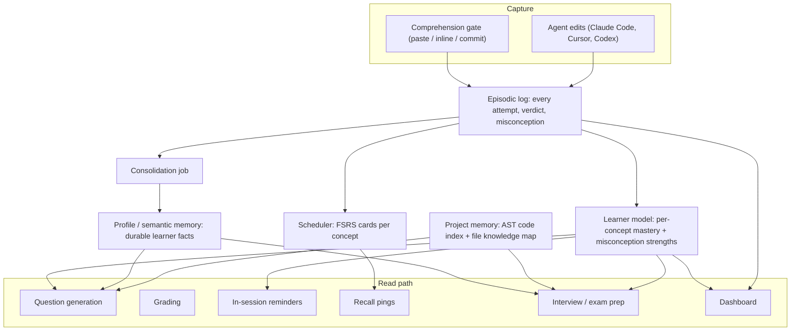
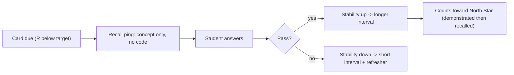
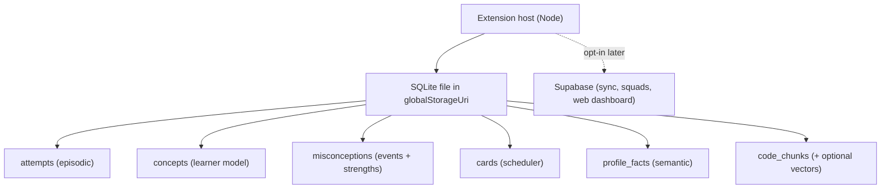

# Memory System Design

How Comprehension Guard can remember what a student understands, what they keep getting wrong, and what their code is about, and how that memory drives reminders, spaced quizzing, and interview/exam prep.

This doc is a research-backed design, not a finished spec. It maps established memory techniques onto the features in [TXC - Education & Opportunity.md](TXC%20-%20Education%20&%20Opportunity.md) and builds on what already exists: the attempt log in [src/store.ts](../src/store.ts), the concept tags and judge-bias math in [llm-grading.md](llm-grading.md), and the grading types in [src/types.ts](../src/types.ts).

---

## 0. The ten decisions that matter most

1. **Memory is five layers, not one blob.** Separate the episodic log (what happened), the learner model (per-concept mastery + misconceptions), the scheduler (when to review), the project/codebase memory (what the code is), and the profile (durable facts about the student). Each is queried differently and fails differently.
2. **Local-first and file-backed.** Keep everything in a local SQLite file under `globalStorageUri`. `globalState` is fine for the MVP but will not scale to per-attempt history + embeddings. Sync to Supabase is opt-in and later.
3. **Concept tags are the backbone (a Q-matrix).** Every attempt, every misconception, every recall card, and every mastery estimate is keyed by a small, canonical concept vocabulary. The quality of the whole system rests on this taxonomy being sharp. This already started in [llm.ts](../src/llm.ts).
4. **Track misconceptions as first-class events, not just "wrong."** A wrong answer should record *which* misconception it matched (off-by-one, mutation-vs-copy, sync/async ordering, shadowing), not only that a criterion failed. This is what powers targeted reminders and interview/exam questions.
5. **Use a simple, interpretable learner model.** With one student and few items per concept, Elo or Bayesian Knowledge Tracing beats deep models; research shows deep knowledge tracing only wins above ~1M interactions and even then by 0.01-0.06 AUC. Start with per-concept Elo + a mastery probability.
6. **Correct for judge bias before updating mastery.** The LLM grader is systematically lenient. Reuse the `p_true = (p_obs - beta) / (1 - alpha - beta)` correction from [llm-grading.md](llm-grading.md) so a lenient pass does not inflate mastery.
7. **Schedule recall with a real forgetting-curve algorithm.** Use FSRS (difficulty/stability/retrievability) or SM-2 as a simpler fallback. Do not invent ad-hoc intervals; the North Star metric (concepts that still hold days later) depends on good spacing.
8. **The read path is retrieval, not dumping everything into the prompt.** When generating a question, grading, or running interview mode, retrieve only the relevant memories (this concept's mastery, recent misconceptions, the specific code) and rank by relevance + recency + importance.
9. **Codebase memory is code RAG.** Index the repo with AST-aware chunking (tree-sitter) + hybrid dense/keyword retrieval, incremental on file change. This is what lets questions and interview prep be about *their* project, not generic.
10. **Consolidate and expire.** Memory that only grows becomes noise. Periodically roll episodic attempts into semantic facts ("Sam reliably explains recursion base cases; still misses aliasing"), and let stale, low-value memories decay.

---

## 1. The five memory layers



### 1a. Episodic memory (already partly built)
The raw event log: one record per check. This already exists as `AttemptRecord` in [src/store.ts](../src/store.ts). It is the source of truth; everything else is derived and can be recomputed from it.

What to add to the current record:
- `questionId` / `templateId` and the rendered question, reference answer, criteria (so attempts are auditable and re-gradeable).
- `misconceptions: string[]` - which misconception tags a wrong answer matched (see section 3).
- `provider`, `promptVersion`, and the existing `judgeConfigId` (for bias correction).
- `source: "paste" | "inline" | "commit" | "recall" | "interview" | "exam"`.
- `filePath`, `repoId`, `commit` when available (links episodic to project memory).
- `latencyMs`, `appealed` (already present).

Keep the full log; derive stats on read (as `getStats` does today). Episodic memory in agent systems is explicitly the "what happened, in what order, with what result" tier, and is pruned/summarized over time, not kept raw forever at scale.

### 1b. Learner model (new): per-concept mastery and misconceptions
A compact, interpretable estimate of "does this student understand concept X" and "which wrong mental models do they hold," updated after each attempt.

Research guidance (knowledge tracing):
- **BKT** (Bayesian Knowledge Tracing): one probabilistic model per skill with four parameters (prior, learn, slip, guess); interpretable, standard for mastery estimation, good when a skill has enough data.
- **Elo / IRT**: a student ability rating per concept and a difficulty rating per question template; after each answer both move by `K * (correct - expected)`. Simple, scalable, handles changing ability, cold-starts well.
- **Deep knowledge tracing (DKT)**: neural; only wins above ~1,000,000 interactions and then by 0.01-0.06 AUC. Not worth it here.
- Logistic models with features (prior successes/failures per skill + item difficulty) lead on small/moderate data.

**Recommendation for us:** per-concept **Elo** for ability, plus a **BKT-style mastery probability** for the dashboard and the mastery gate in the North Star metric. Store per concept:
```
concept, ability (Elo), masteryProb (0..1), attempts, lastSeen, templateDifficulty map
```
Update ability with the usual Elo step; update `masteryProb` with a BKT transition. Both are cheap and explainable ("you are at 1240 on recursion, mastery 0.78").

**Bias correction (important):** before an attempt updates mastery, discount the judge's leniency using the gold-set rates from [llm-grading.md](llm-grading.md) section 9: `p_true = (p_obs - beta) / (1 - alpha - beta)`, where `beta` is false-pass and `alpha` is false-fail for the current `judgeConfigId`. A pass from a lenient local model should move mastery less than a pass from a validated strict judge.

### 1c. Scheduler (new): spaced recall
A forgetting-curve model that decides *when* to re-ask a concept with no code shown (Use Case 3, "recall ping"; P1 feature).

Research guidance (spaced repetition):
- **FSRS** models each item as Difficulty, Stability, Retrievability; predicts recall probability and schedules the next review to hit a target retention; runs fully locally; ~20-30% fewer reviews than SM-2 for the same retention. A TypeScript implementation exists (`ts-fsrs`).
- **SM-2 / Leitner**: simpler, battle-tested, easy to implement in a few lines; good enough for a first version.

**Recommendation for us:** one scheduler "card" per concept (optionally per concept+project). Start with **SM-2** for the MVP (trivial to implement, no tuning), then swap in **FSRS** via `ts-fsrs` once there is review history, behind the same interface. A pass pushes the interval out; a miss shortens it and triggers a refresher. Respect quiet hours, a daily cap (1-2 pings), and snooze, as the spec requires.



### 1d. Project / codebase memory (new): code RAG + file knowledge map
So questions and interview prep are about the student's actual project (differentiator #4, Use Case 4, Use Case 7).

Research guidance (code RAG):
- **AST-aware chunking** with tree-sitter: chunk at function/class/method boundaries, merge tiny siblings, split oversized nodes; store `path`, `lineRange`, `symbol`, `signature`, `imports`. AST chunking measurably beats line-based chunking for retrieval.
- **Hybrid retrieval:** dense embeddings for meaning + BM25 for exact identifiers, fused with Reciprocal Rank Fusion, optional rerank.
- **Repo map:** a tree-sitter symbol/dependency map (Aider-style) gives the LLM the shape of the repo within a token budget, with no embeddings at all - cheap and a good first step.
- **Incremental index:** content-hash or Merkle per file; re-embed only changed files; a debounced file watcher keeps it live.
- **Local-first embeddings** exist (ONNX/fastembed) so this can run with no API key.

**Recommendation for us:** start with a **repo map** (tree-sitter signatures, no vectors) plus the **file knowledge map** (who has demonstrated understanding of which file, derived from episodic `filePath`). Add a full AST + hybrid vector index later for deep interview mode. The file knowledge map directly powers Use Case 7 (project squad) and feeds "which parts were AI-written and not yet understood."

### 1e. Profile / semantic memory (new): durable learner facts
Short, durable statements about the student that are expensive to recompute and useful across sessions: "prefers Python," "strong on control flow, weak on aliasing," "interview is Nov 20," "doing the malloc lab." This is the mem0/Letta "semantic memory" tier.

Research guidance (agent memory):
- **Extract-then-reconcile** (mem0): after a session, extract salient facts, compare to existing memories by similarity, and apply ADD / UPDATE / DELETE / NOOP so the store stays consistent instead of duplicating.
- **Tiered memory** (MemGPT/Letta): a small always-in-context "core" set of facts plus a larger searchable archive paged in on demand.
- **Ranking on read:** relevance + recency + how often a memory proved useful.

**Recommendation for us:** a small table of typed facts (`kind`, `value`, `confidence`, `updatedAt`, `source`). Run a cheap consolidation pass at session end that turns episodic streaks into profile facts (this can be deterministic first; LLM-assisted dedupe later). Inject only the few relevant facts into generation/interview prompts, never the whole store.

---

## 2. Storage architecture



- **MVP (now):** keep `globalState` as-is; just enrich `AttemptRecord`. No new deps.
- **Next:** move to a local SQLite file via `context.globalStorageUri` + `better-sqlite3` (synchronous, fast, prebuilt binaries). Add `sqlite-vec` only when the vector index for code/interview lands. This keeps everything local and private by default, matching the spec's "data stays on the student's machine."
- **Later:** opt-in Supabase sync for squads, leaderboards, and the web dashboard (the spec's P2/P3). Sync derived/shareable data, not raw code. Keep `secrets` (API keys) where they are.

Migration: write a tiny exporter from the current `globalState` attempts array into the `attempts` table so no history is lost.

---

## 3. The concept taxonomy and misconception tracking

This is the backbone and the part the user specifically wants, so it gets its own section.

### Concept tags (Q-matrix)
Reuse and formalize the tag set already in [llm.ts](../src/llm.ts) (`control-flow`, `data-structures`, `mutation-aliasing`, `async-concurrency`, `error-handling`, `complexity`, `api-semantics`, `types`, `recursion`, `io`). Rules from [llm-grading.md](llm-grading.md) section 2c apply:
- One canonical definitions file, pasted verbatim into every prompt that uses tags.
- Counterfactual test for tagging ("could a student lacking X still answer?"); under-tag rather than over-tag.
- Worked positive/negative examples per tag (fuzzy definitions get poor agreement).

### Misconceptions as first-class events
A misconception is a specific wrong mental model, not just a failed criterion. The MCQ distractors in [llm.ts](../src/llm.ts) already encode misconceptions (off-by-one, mutation vs copy, sync/async ordering, shadowing). Extend this everywhere:

- Add a `misconceptionTag` to MCQ distractors and to negative criteria, so when the student picks that distractor or trips that negative criterion, the system records *which* misconception fired.
- Store misconception events: `{ conceptTag, misconceptionTag, timestamp, filePath }`.
- Maintain a per-misconception **strength** that rises on repeat and decays when the student later answers a related item correctly. High-strength misconceptions are what reminders, interview mode, and exam prep target.

```ts
// extends the grading types in src/types.ts
type Misconception = { id: string; conceptTag: string; label: string };
type MisconceptionEvent = { misconceptionId: string; timestamp: number; filePath?: string; source: string };
type MisconceptionState = { misconceptionId: string; strength: number; lastSeen: number; resolved: boolean };
```

This is the data that makes the product's differentiator #4 ("knows what you skipped") real.

---

## 4. How memory is used (the read path)

Memory is only valuable if it changes what the student sees. Key integration points, all in the existing extension:

1. **Question generation ([llm.ts](../src/llm.ts) `generateQuestion`):** inject (a) the student's current mastery for the snippet's likely concepts, (b) their top unresolved misconceptions for those concepts, and (c) the relevant code context from project memory. Bias new questions toward weak concepts and known misconceptions. Pre-generation and caching from [llm-grading.md](llm-grading.md) section 1 still apply.
2. **Grading ([llm.ts](../src/llm.ts) `judge`):** unchanged scoring, but the *result* updates the learner model (bias-corrected), misconception strengths, and the scheduler card.
3. **In-session reminders:** when a paste touches a concept the student has an active misconception on, show a short reminder ("last time, aliasing tripped you up here - watch the shared reference") before or with the question. This is the "use it during sessions" ask.
4. **Recall pings (scheduler):** FSRS/SM-2 picks a due concept and asks with no code shown; the result feeds back.
5. **Interview / exam prep:** retrieve the student's AI-written-but-unverified code (episodic + project memory) and their weak concepts/misconceptions (learner model), and generate a project deep-dive or spaced exam set targeting exactly those. Exam prep tightens spacing toward the entered exam date.
6. **Dashboard:** read-model over the learner model + episodic log: concepts proven and kept, weak spots, trend, recall retention. Report mastery as a bias-corrected range, and separate "improving" (robust) from "knows X" (bias-sensitive), per [llm-grading.md](llm-grading.md) section 9.

---

## 5. Feature-to-memory mapping

| Spec feature | Memory layers used | Notes |
|---|---|---|
| Hold until understanding (P0) | episodic, learner, project | already works; add misconception capture |
| Local session log (P0) | episodic | exists; migrate to SQLite |
| Recall pings (P1) | scheduler, learner | SM-2 now, FSRS later |
| Dashboard (P1) | learner, episodic | bias-corrected mastery ranges |
| Strictness / modes (P1) | learner | adapt depth from mastery |
| Interview mode (P2) | project, learner, profile, episodic | questions from their code + weak spots |
| Exam prep (P2) | scheduler, learner | spacing tightens before exam date |
| Project squad file map (P3) | project, episodic | who understands which file |
| Instructor presets (P3) | concept taxonomy | preset = concept set + min depth |

North Star metric ("concepts demonstrated, then recalled later with no assistant") is computed directly from episodic + scheduler: a concept counts when it has a passed in-session check followed by a passed recall ping.

---

## 6. Phased implementation plan

Proportional to current state (single-user, extension-only, LLM + grading working).

**Phase 1 - enrich what exists (small):**
- Extend `AttemptRecord` with `misconceptions`, `questionId`, `source`, `filePath`.
- Add `misconceptionTag` to MCQ distractors and negative criteria in [llm.ts](../src/llm.ts); record which fired.
- Derive a simple per-concept mastery (pass-rate, bias-corrected) in [store.ts](../src/store.ts); surface in the stats view.

**Phase 2 - learner model + scheduler (medium):**
- Introduce the local SQLite store under `globalStorageUri`; migrate attempts.
- Add `concepts` (Elo + mastery) and `cards` (SM-2) tables; update both on each graded attempt.
- Ship recall pings (Use Case 3) with quiet hours, daily cap, snooze.
- Inject mastery + top misconception into `generateQuestion`; add in-session reminders.

**Phase 3 - project memory (medium):**
- Tree-sitter repo map + file knowledge map (no vectors yet).
- Use repo map as context in generation; show file knowledge map for a repo.

**Phase 4 - Pro modes + depth (larger):**
- FSRS via `ts-fsrs` behind the scheduler interface; exam-date-aware spacing.
- AST + hybrid vector index (`sqlite-vec`, local embeddings) for interview deep-dive.
- Consolidation job -> profile facts; LLM-assisted dedupe (mem0-style ADD/UPDATE/DELETE/NOOP).

**Phase 5 - sync and social (later):**
- Opt-in Supabase sync; squads, leaderboards, web dashboard (spec P2/P3).

---

## 7. Risks and open questions

- **Taxonomy drift / mis-scoped tags.** A spurious concept tag quietly corrupts the learner model. Under-tag, keep one definitions file, and audit tags where judge and human disagree.
- **Judge bias compounding.** Mastery built on an unvalidated lenient judge will be wrong. Gate mastery updates on a known `judgeConfigId` with measured alpha/beta; show ranges, not points.
- **Cold start.** With few attempts, mastery is noisy. Elo cold-starts acceptably; show low confidence until a few attempts exist.
- **Notification fatigue.** Recall pings must respect caps, quiet hours, snooze; track snooze/mute as a guardrail metric.
- **Native deps.** `better-sqlite3` / `sqlite-vec` need prebuilt binaries per platform; test packaging across Windows/mac/Linux, or keep a pure-JS fallback.
- **Privacy.** Code and learning data stay local by default; sync is opt-in and should exclude raw source. Keep this explicit in settings.
- **Scope.** Deep code RAG and FSRS optimization are large; the repo map + SM-2 give most of the value first.

---

## Modes

`comprehensionGuard.mode` is `auto`, `learn`, or `walkthrough`. Auto keeps a single check unless an agent changes at least 7 files or 500 lines, then it offers a walkthrough. Session count follows how many core files are still below mastery, not a fixed script of three. The understanding map colors files from mastery times recall retrievability, so a file fades when the concept is not reviewed. Login opens one due recall instead of a notification. Each graded check, bypass, and explanation is a `review_events` row (question and answer included, source code excluded). Interview and exam questions are generated on the machine and synced as `prep_sets`.

Agents with a pause hook are held one chunk at a time. Tree-sitter scores the changed functions, maps each one onto the same concept tags as Bayesian mastery, and skips a chunk the student already knows unless an exam or interview is close. The question itself is generated and graded by the shared quiz engine (predict and multiple choice stay deterministic, explain uses the free-response judge, change unlocks the editor). A pass or fail updates mastery, the recall card, and the review log. While that pause is active, the post-edit walkthrough does not quiz the same file again.

## 8. References

Spaced repetition:
- FSRS (DSR model, 21 params, local): https://github.com/open-spaced-repetition/free-spaced-repetition-scheduler and ts-fsrs https://github.com/open-spaced-repetition/ts-fsrs
- Anki on FSRS vs SM-2: https://docs.ankiweb.net/faqs/what-spaced-repetition-algorithm

Knowledge tracing / learner models:
- BKT, Elo, deep KT overview: https://peabody.kids/blog/knowledge-tracing-explained-bkt-elo-deep-learning
- 25 years of BKT (review): https://dl.acm.org/doi/10.1007/s11257-023-09389-4

Agent memory:
- Mem0 (extract + ADD/UPDATE/DELETE/NOOP): https://arxiv.org/html/2504.19413
- Agent memory tiers (episodic/semantic/procedural): https://mem0.ai/library/agent-memory/memory-in-agents-what-why-and-how

Code RAG / codebase memory:
- AST chunking + repo maps + hybrid retrieval: https://balazscsorba.com/blog/code-rag-repository-indexing
- Local-first code RAG example: https://github.com/Neverdecel/CodeRAG

VS Code local storage:
- Storage options (globalStorageUri etc.): https://code.visualstudio.com/api/extension-capabilities/common-capabilities
- sqlite-vec in Node: https://alexgarcia.xyz/sqlite-vec/js.html ; better-sqlite3: https://www.npmjs.com/package/better-sqlite3
